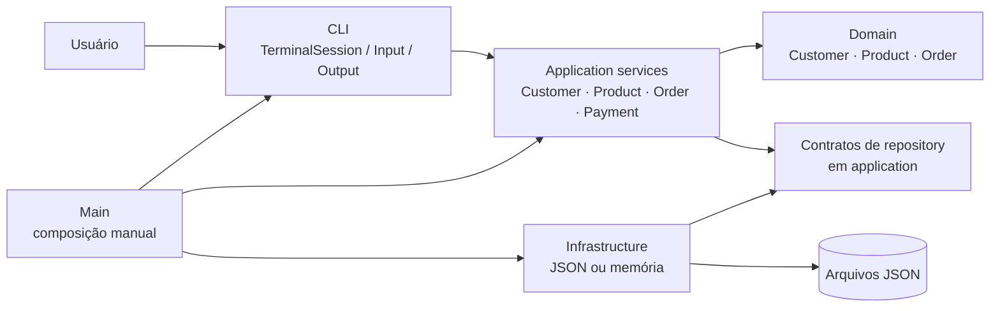
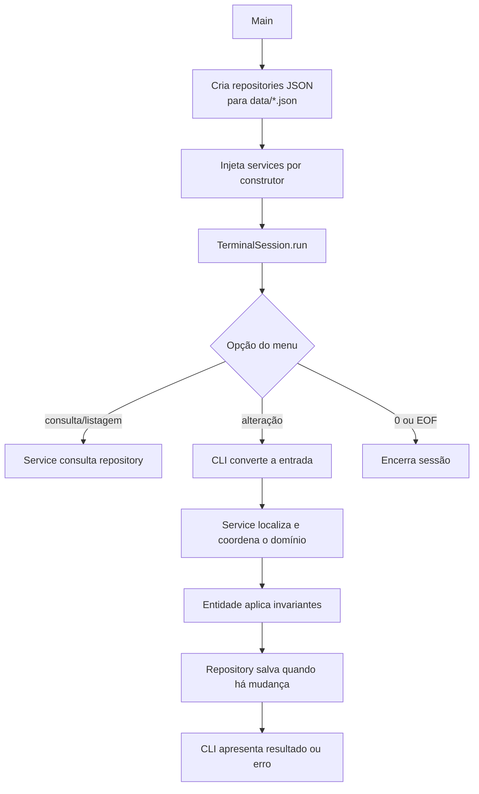
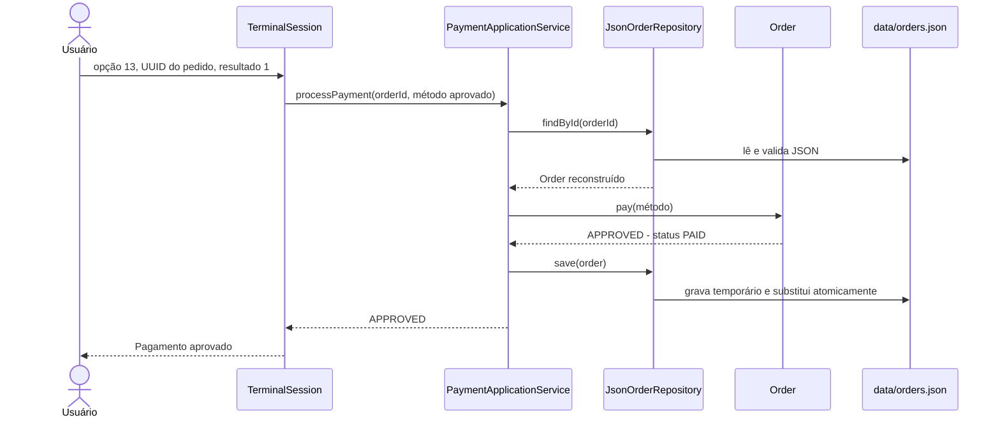

# Order Management CLI

Aplicação educacional de gestão de pedidos em Java 21, executada no terminal. O projeto foi concebido para exercitar fundamentos da linguagem, da JDK, do Maven e de testes automatizados antes da introdução de frameworks: a pergunta que o orienta é **“eu sei Java ou simplesmente sei Spring?”**. Por isso, **Spring, ORM, banco de dados e containers de injeção de dependência não fazem parte desta aplicação**.

O sistema cadastra clientes e produtos, cria pedidos, mantém seus itens, simula a aprovação ou recusa de pagamentos e persiste os dados em arquivos JSON. Também há uma API de aplicação para gerar relatórios de vendas; ela está implementada e testada, mas ainda não possui opção no menu do terminal.

> [!NOTE]
> Este README descreve o estado presente do repositório. Recursos como descontos, estoque, cancelamento, meios de pagamento reais, concorrência, banco de dados e uma CLI para relatórios são evoluções possíveis, não funcionalidades atuais.

## Visão geral

Um pedido precisa conservar informações comerciais mesmo quando o catálogo muda. Por exemplo, um item já incluído não pode passar a exibir automaticamente o novo nome ou preço de um produto. A solução modela esse problema com um agregado `Order`: ao adicionar um `Product`, o pedido cria um `OrderItem` com um *snapshot* de identificador, nome e preço unitário.

O escopo atual é deliberadamente pequeno e centrado em regras de domínio:

- cadastro, consulta e listagem de clientes e produtos;
- criação, consulta e listagem de pedidos;
- inclusão, alteração de quantidade e remoção de itens enquanto o pedido está em `DRAFT`;
- subtotal monetário com `BigDecimal`;
- pagamento simulado, com transição para `PAID` somente quando aprovado;
- relatório programático de vendas por intervalo, com receita apenas de pedidos pagos e agrupamento por cliente;
- repositórios em memória para testes/composição alternativa e persistência JSON como composição padrão da CLI.

As evoluções são especificadas em [`specs/`](specs/README.md). As SPEC-001 a SPEC-012 estão registradas como concluídas; cada uma delimita uma unidade de aprendizado e evita antecipar funcionalidades.

## Arquitetura

O projeto segue uma arquitetura em camadas simples, com raiz de composição manual em [`Main.java`](src/main/java/dev/manoelreis/ordermanagement/cli/Main.java). Não é uma implementação completa de Clean/Hexagonal Architecture: é uma separação pragmática de responsabilidades para manter o domínio independente de terminal, arquivos e Jackson.



O diagrama mostra duas direções diferentes: a CLI chama os casos de uso, enquanto a infraestrutura implementa os contratos de persistência definidos mais perto dos casos de uso. Assim, `application` não importa Jackson nem `Path`, e `domain` não importa `application`, infraestrutura ou CLI.

| Área | Responsabilidade e elementos reais |
| --- | --- |
| `domain` | Regras, estado e invariantes de `Customer`, `Product`, `Order`, `OrderItem`, IDs tipados, status e contrato de pagamento. |
| `application` | Orquestra casos de uso e depende das interfaces `CustomerRepository`, `ProductRepository` e `OrderRepository`. Inclui os serviços de cliente, produto, pedido, pagamento e relatório. |
| `infrastructure.persistence` | Implementa os contratos: mapas em memória e arquivos JSON. É a única área que conhece Jackson e File I/O. |
| `cli` | Lê e valida formato de entrada, aciona serviços e renderiza mensagens. Não contém regras de negócio. `Main` é a raiz de composição. |

### Fluxo de execução da CLI



A CLI não captura toda exceção indistintamente: trata os erros de formato, exceções de domínio e casos de entidade ausente nos fluxos em que isso é esperado. Já uma `JsonPersistenceException` sobe até `Main`, que comunica a falha em `stderr` e encerra a sessão; continuar após uma falha de armazenamento poderia induzir o usuário a acreditar que um estado foi persistido.

### Fluxo de dados e persistência

`JsonCustomerRepository`, `JsonProductRepository` e `JsonOrderRepository` recebem um `Path` e leem o arquivo em cada operação. Ao salvar, cada repositório lê e valida a coleção inteira, substitui ou acrescenta o registro pelo ID e publica o novo array em JSON. A escrita é feita em arquivo temporário no mesmo diretório e usa `ATOMIC_MOVE`; se o sistema de arquivos não suportar a troca atômica, a operação falha explicitamente em vez de recorrer a escrita direta.

Os documentos JSON são representações internas da infraestrutura, não a serialização direta das entidades. Isso evita anotações Jackson, construtores vazios ou setters artificiais no domínio. Na leitura, a infraestrutura valida estrutura e tipos, converte documentos para objetos de domínio e usa `Order.restore`/`OrderItem.restore` para reconstruir o estado sem reaplicar um pagamento.

## Fundamentação teórica aplicada

### Encapsulamento e invariantes

Encapsulamento faz o objeto proteger as condições que o mantêm válido. Aqui, `Customer` normaliza e valida nome/e-mail; `Product` exige preço positivo com no máximo duas casas; `Order` restringe a edição a `DRAFT`; e `OrderItem` exige quantidade positiva. As mutações ocorrem por operações semânticas como `rename`, `changePrice`, `addProduct` e `pay`, em vez de setters genéricos.

Isso concentra regras próximas do estado que elas protegem e evita pedidos parcialmente válidos. Como consequência, os serviços não repetem validações de negócio. A limitação é intencional: o modelo ainda não cobre descontos, totais além do subtotal ou transições como cancelamento.

### Agregado, identidade e snapshot comercial

`Order` é a fronteira de consistência dos itens: internamente usa `LinkedHashMap<ProductId, OrderItem>`, garantindo um item por produto e preservando a ordem de inserção. Sua API expõe `List.copyOf`, portanto o chamador não consegue modificar a coleção estruturalmente. Os IDs são `record`s distintos (`CustomerId`, `ProductId`, `OrderId`) que encapsulam `UUID`; o sistema de tipos impede misturar identificadores de conceitos diferentes.

Ao incluir um produto, `OrderItem.from` copia nome e preço. Essa escolha preserva a evidência comercial do pedido; renomear ou alterar o preço no catálogo não modifica o item existente. Em contrapartida, o item não aponta para um produto “sempre atualizado”, o que é adequado para o escopo de pedido, mas exigiria decisões adicionais caso houvesse políticas de reajuste retroativo.

### Separação de responsabilidades e inversão de dependência

Os serviços dependem de interfaces específicas de repositório situadas em `application`, com `save`, `findById` e `findAll`. A infraestrutura aponta para esses contratos e os implementa, invertendo a dependência concreta de persistência: trocar um `InMemory*Repository` por um `Json*Repository` não muda os serviços nem o domínio. A injeção é manual, por construtor, em `Main` e nos testes.

O benefício é testar a orquestração com dublês ou repositórios reais simples e aprender claramente onde as dependências são criadas. O custo é a composição explícita e a necessidade de adicionar manualmente novos colaboradores; não existe descoberta automática de componentes.

### Tipos de valor, dinheiro e tempo

Valores monetários usam `BigDecimal`, nunca `double`/`float`. `Product` e `OrderItem` normalizam para escala 2 com `RoundingMode.UNNECESSARY`, rejeitando valores que precisariam de arredondamento. O instante de criação é `Instant`; `OrderApplicationService` recebe `Clock`, o que deixa testes determinísticos e permite que a composição de produção escolha `Clock.systemUTC()`.

Essa disciplina reduz erros de ponto flutuante e de fuso horário, mas não implementa moeda, impostos, arredondamentos de regras fiscais ou internacionalização.

### Programação funcional localizada e coleções

O projeto combina orientação a objetos no domínio com Streams onde agregação e filtragem são mais expressivas. `ReportApplicationService.generateSalesReport` filtra o intervalo semiaberto `[início, fim)`, seleciona pedidos `PAID`, soma subtotais e agrupa por `CustomerId`. O resultado é transportado por records (`SalesReport` e `CustomerSales`) e a lista agrupada é copiada defensivamente.

Streams não substituem todos os laços: a restauração de pedidos usa iteração explícita para validar duplicidade e reconstruir ordem. A escolha prioriza legibilidade e demonstra que programação funcional é uma ferramenta, não uma regra universal.

### Tratamento de falhas em fronteiras

Exceções de domínio (`InvalidProductException`, `InvalidQuantityException`, `DomainException` e similares) sinalizam violações de regra. Exceções de aplicação como `OrderNotFoundException` distinguem ausência de entidade de falha técnica. Na borda de infraestrutura, `JsonPersistenceException` preserva causa e caminho afetado. `TerminalInput` usa `Optional` para conversões que legitimamente podem não produzir um valor, como UUID inválido.

Essa classificação permite mensagens adequadas sem transformar exceções em fluxo normal. Ela não fornece recuperação automática para arquivos corrompidos, retentativas ou transações entre arquivos — limitações documentadas abaixo.

## Tecnologias e ferramentas

| Tecnologia | Papel no projeto | Integração |
| --- | --- | --- |
| Java 21 | Linguagem e biblioteca padrão: records, `Optional`, Streams, `java.time`, `BigDecimal`, coleções e NIO. | O compilador Maven usa `release` 21. |
| Maven Wrapper / Maven | Build, resolução de dependências, testes e empacotamento. | `maven-dependency-plugin` copia dependências de runtime para `target/dependency/`. |
| Jackson Databind 2.21.6 + JSR-310 | Serialização e leitura JSON na infraestrutura. | `JsonFileStore` configura leitura estrita e `JavaTimeModule`; o domínio não depende de Jackson. |
| JUnit Jupiter 5.14.4 | Testes unitários e de integração local. | Exercita domínio, serviços, CLI e repositórios em memória. |
| Mockito Core 5.23.0 | Isolamento de colaboradores onde pertinente. | Declarado apenas no escopo de teste; objetos reais também são usados em diversos testes. |

As versões acima vêm de [`pom.xml`](pom.xml). A justificativa de manter Java e bibliotecas sem framework é registrada nas especificações e em [`AGENTS.md`](AGENTS.md); a escolha de Jackson é limitada à persistência JSON.

## Estratégias de implementação e decisões

As decisões abaixo são rastreáveis ao código e às SPECs. A coluna “base” diferencia decisão explicitamente registrada de análise arquitetural derivada da implementação.

| Decisão | Contexto e justificativa | Trade-off e alternativas | Base |
| --- | --- | --- | --- |
| Domínio sem dependências técnicas | Entidades e regras precisam ser utilizáveis e testáveis sem terminal, arquivos ou JSON. | Exige mapeamento explícito na infraestrutura; serialização direta das entidades seria menor, porém acoplaria o domínio. | SPEC-002/012 e imports do código |
| Repositórios específicos em `application` | Clientes, produtos e pedidos têm contratos pequenos e necessários aos casos de uso. | Há repetição entre interfaces; um repository genérico foi deliberadamente evitado para não antecipar abstrações. | SPEC-003/004/005/008 |
| Injeção manual por construtor | Permite observar a composição e trocar infraestrutura sem container. | Mais código de ligação em `Main`; um container DI reduziria isso, mas é proibido no escopo educacional atual. | `AGENTS.md`, `Main.java` e SPECs |
| `LinkedHashMap` + snapshots imutáveis | Preserva ordem de primeira inserção, garante chave única e evita exposição estrutural mutável. | Estado é mantido em memória por entidade; consulta não oferece paginação/filtros. | `Order.java` e repositories |
| JSON por entidade e troca atômica por arquivo | Entrega durabilidade simples, legível e sem banco de dados, preservando o arquivo anterior se a publicação falhar. | Não há transação entre `customers.json`, `products.json` e `orders.json`, locks, cache, concorrência nem `fsync`. | SPEC-012 e `JsonFileStore.java` |
| Pagamento como estratégia funcional simulada | `PaymentMethod` é uma interface funcional e a CLI fornece lambdas que aprovam/recusam. | Não há gateway, autenticação, captura de transação ou histórico de pagamentos; integração real deve ser uma evolução própria. | `PaymentMethod.java`, `TerminalSession.java`, SPEC-006/011 |
| Receita baseada somente em `PAID` | Pedidos em rascunho podem ter subtotal, mas não representam receita realizada. | O relatório é somente API e filtra por data de criação, não por data de pagamento, que ainda não existe no modelo. | `ReportApplicationService.java` e SPEC-007 |

## Estrutura do projeto

```text
.
├── data/                              # destino de runtime; conteúdos são ignorados pelo Git
├── specs/                             # 12 incrementos planejados e concluídos
├── src/
│   ├── main/java/dev/manoelreis/ordermanagement/
│   │   ├── domain/                    # regras, entidades, IDs, status e exceções
│   │   ├── application/               # casos de uso, contratos e resultados de relatório
│   │   ├── infrastructure/persistence/
│   │   │   ├── memory/                # repositories em LinkedHashMap
│   │   │   └── json/                  # Jackson, File I/O e mapeamento explícito
│   │   └── cli/                       # Main, sessão, entrada e saída do terminal
│   └── test/java/dev/manoelreis/ordermanagement/
│       ├── domain/
│       ├── application/
│       ├── infrastructure/
│       └── cli/
├── AGENTS.md                          # princípios e restrições globais
├── pom.xml                            # build e dependências
├── mvnw / mvnw.cmd                    # Maven Wrapper
└── README.md
```

## Funcionamento de ponta a ponta: aprovar um pedido

O pagamento demonstra a colaboração entre as camadas e a mudança de estado mais relevante do sistema.



1. O usuário escolhe a opção `13`, informa um UUID de pedido e seleciona `1` (aprovar) ou `2` (recusar). `TerminalInput` valida apenas o formato do UUID; a CLI transforma a escolha em um `PaymentMethod` determinístico.
2. `PaymentApplicationService.processPayment` localiza o pedido pelo `OrderRepository`. Se não existir, lança `OrderNotFoundException` e a CLI informa a ausência.
3. `Order.pay` exige estado `DRAFT` e pelo menos um item. O método chama a estratégia com o subtotal. Na aprovação, muda o estado para `PAID`; na recusa, mantém `DRAFT`.
4. O serviço salva somente aprovações, pois somente elas alteram o pedido. Na composição padrão, `JsonOrderRepository` persiste o novo estado em `data/orders.json`.
5. Depois de pago, o agregado rejeita alterações nos itens e novo pagamento com `DomainException`. Falha de JSON encerra a sessão, preservando o arquivo anterior quando a troca atômica falha antes da publicação.

Exemplo conceitual: após cadastrar um produto por `100.00`, adicioná-lo duas vezes a um pedido (quantidades `1` e `2`) resulta em um único item com quantidade `3` e subtotal `300.00`. Se aprovado, o pedido passa a `PAID`; mudar depois o preço do produto cadastrado não altera o preço registrado nesse item.

## Instalação, build e execução

### Pré-requisitos

- JDK 21 disponível em `JAVA_HOME` ou `PATH`;
- shell Unix para os comandos abaixo (no Windows, use `mvnw.cmd` e adapte o separador de classpath para `;`);
- acesso à internet na primeira execução, para o Maven Wrapper baixar o Maven e as dependências.

Não há variáveis de ambiente, serviços externos, banco de dados ou credenciais necessárias.

```bash
# Compila, executa os testes e copia dependências de runtime para target/dependency/
./mvnw clean package

# Executa somente os testes
./mvnw test

# Executa a CLI a partir da raiz do repositório
java -cp 'target/order-management-cli-0.1.0-SNAPSHOT.jar:target/dependency/*' \
  dev.manoelreis.ordermanagement.cli.Main
```

O JAR não inclui dependências; por isso o classpath aponta também para `target/dependency/*`. A CLI resolve `data/customers.json`, `data/products.json` e `data/orders.json` relativamente ao diretório de trabalho. Consultas em armazenamento inexistente retornam vazio; o primeiro salvamento cria o diretório e o arquivo necessários.

O menu atual oferece cadastro, listagem e busca de clientes/produtos; criação, listagem, busca e manutenção de itens de pedidos; e pagamento simulado. Há métodos de alteração de cliente e produto nos serviços de aplicação, mas eles **não têm opção de menu** nesta versão. Da mesma forma, o relatório é disponibilizado por `ReportApplicationService`, não pela CLI.

## Qualidade, validação e limitações

Há 18 classes de teste e 201 testes executados pelo Maven no estado inspecionado do repositório. A cobertura é estruturalmente distribuída entre domínio, serviços de aplicação, CLI e persistência. Os cenários exercitam, entre outros, normalização/validação, invariantes de pedido, transições de pagamento, listas não modificáveis, ordenação/agrupamento de relatórios e mensagens/EOF da CLI. [`JsonPersistenceTest`](src/test/java/dev/manoelreis/ordermanagement/infrastructure/persistence/json/JsonPersistenceTest.java) cobre round-trip, arquivo ausente e rejeição de documento inválido sem sobrescrita.

Essa evidência não equivale a uma garantia de cobertura completa: por exemplo, o conjunto JSON observável possui três cenários, enquanto a SPEC-012 prevê uma matriz maior de casos de integridade e falhas. Execute `./mvnw test` e `./mvnw clean package` ao alterar o projeto; estes comandos são a verificação mínima documentada pelo Maven e passaram nesta revisão.

Limitações relevantes e intencionais do escopo:

- pagamento é uma simulação local; não há provedor financeiro, dados de pagamento, idempotência ou auditoria;
- relatórios não são acionáveis pela CLI e usam data de criação do pedido;
- não há descontos, impostos, frete, estoque, cancelamento, exclusão, autenticação ou autorização;
- JSON não oferece consultas eficientes para grande volume: cada operação relê e revalida o arquivo inteiro;
- a atomicidade é por arquivo, não por operação envolvendo múltiplos arquivos; não há concorrência entre processos, locks, backup, migração/versionamento de esquema, recuperação de corrupção ou garantia contra queda de energia;
- uma inconsistência referencial entre arquivos (por exemplo, pedido para cliente removido manualmente) não é reconciliada pela infraestrutura;
- não há métricas de cobertura, benchmark ou avaliação de desempenho versionados no repositório.

## Aprendizados técnicos e caminhos de evolução

O valor educacional deste código está menos em “chegar a um sistema completo” e mais em tornar fronteiras visíveis: invariantes ficam em entidades, orquestração fica em serviços, persistência é substituível por contrato e a CLI não recebe regras que pertencem ao domínio. A implementação também mostra que persistência não se resume a serializar objetos: reconstruir estado precisa manter invariantes, snapshots e distinção entre dados de negócio e detalhes técnicos.

Temas que podem fundamentar a próxima evolução, sem pressupor que já estejam implementados:

1. Adicionar uma apresentação de `ReportApplicationService` à CLI e decidir como coletar intervalos `Instant` de forma usável.
2. Criar testes de integração com diretórios temporários para o contrato JSON, especialmente round-trip, documento inválido e publicação atômica.
3. Modelar novas transições de pedido (por exemplo, cancelamento) somente depois de definir regras, efeitos no relatório e persistência.
4. Avaliar uma estratégia de consistência para operações que cruzem arquivos antes de introduzir banco de dados ou abstrações transacionais.
5. Introduzir um adaptador de pagamento real apenas quando houver requisitos de segurança, idempotência, auditoria e tratamento de falhas adequados.

Para um artigo técnico curto, os temas mais férteis são: (1) domínio rico e invariantes no `Order`; (2) snapshots comerciais em `OrderItem`; (3) inversão de dependência e injeção manual sem Spring; (4) persistência JSON com mapeamento explícito e publicação atômica; e (5) `BigDecimal`/`Clock` como escolhas de correção e testabilidade.
